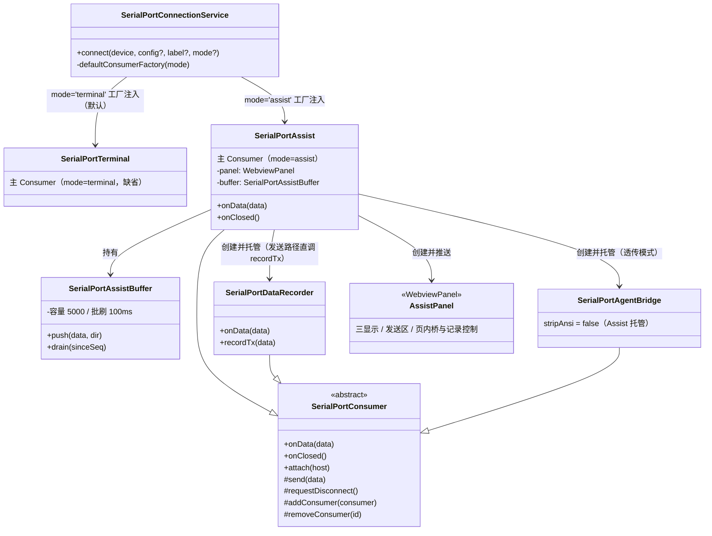

# SerialPortAssist（串口助手）设计

> 状态：设计定稿（2026-11-23，P0/P1 待实施）｜ 目录：`src/SerialPortConsumer/SerialPortAssist/`（计划）｜ 规范：[SerialPortConsumer设计.md](SerialPortConsumer设计.md) ｜ 上位文档：[../总体架构.md](../总体架构.md) ｜ 关联：[SerialPortAgentBridge设计.md](SerialPortAgentBridge设计.md)、[SerialPortLogRecorder设计.md](SerialPortLogRecorder设计.md)、[SerialPortMacroSender设计.md](SerialPortMacroSender设计.md)

## 1. 定位（需求来源：2026-11-07 用户需求；2026-11-23 设计定稿）

面向调试与测试的**纯字节流**串口工具：数据原样发送、原样接收、原样落盘，与面向终端交互的 SerialPortTerminal 并列的第二种**主 Consumer** 类型，由连接模式选择。

起因（Terminal 形态的三点不足）：①AgentBridge 面向终端，可纯字节发送但无法向用户展示发送的数据（不透明）；②接收链路带 ANSI 剥离，二进制协议可能被 UTF-8 往返损坏；③无数据保存能力。SerialPortAssist 以 WebviewPanel 承载，三者在页内闭环：收发双向可见、桥固定透传、DataRecorder 双向落盘。

## 2. 设计目标

- **原样收发**：不剥离、不加工、不加协议——接收即显示即落盘，发送即字节原文；
- **双向透明**：发送数据本地即时可见（TX）并落盘，接收广播照常（RX）——消除「发了什么」的不透明；
- **主 Consumer 互斥**：同设备同一时刻仅一种主 Consumer，由连接模式决定，无热切换；
- **依附复用**：DataRecorder 与 AgentBridge 以依附型 Consumer 挂在 Assist 下，生命周期模式复用 LogRecorder / Terminal 先例；
- **零新增设置**：行尾符、显示模式、渲染上限均为页内会话态或固定常量，不进 settings。

## 3. 主 Consumer 语义（本设计确立）

- **主 Consumer 由连接模式决定**：`connect(device, config?, label?, mode)` 的 `mode` ∈ `'terminal' | 'assist'`（缺省 `'terminal'`，全部既有调用方零改动），Service 经工厂 `(mode) => SerialPortConsumer` 创建主 Consumer；主 Consumer 仍在构造 Connection 时注入（首 Consumer 先于句柄订阅，onOpen 横幅可达——既有时序不变）；
- **互斥**：每设备单连接 + `status 非 disconnected 拒绝`守卫天然保证；切换模式 = 断开 → 以另一模式重连（无热切换——会话迁移语义成本不成立）；
- **依附型挂主**：DataRecorder / AgentBridge 由 Assist 经 `host.addConsumer` 注册并托管，与 LogRecorder / AgentBridge 挂 Terminal 同构；
- **减为零规则不变**：主 Consumer 随断开销毁即关闭串口；
- **全局宏是 Terminal 专属发送能力，不是 Consumer**：MacroSender 维持全局组件（globalState + 树视图），目标解析经 `activeTerminal → 串口终端实例映射`，结构性只可达 Terminal 连接（WebviewPanel 不入 `activeTerminal`）；Assist 连接下宏发送提示「无活动串口连接」。2026-11-23 已核查双主 Consumer 形态无新增 bug：Assist 面板不进终端映射、冻结终端由 `getConnection` miss 兜底、映射表双路清理无泄漏。

## 4. Service 改造（唯一服务层改动）

| 项 | 契约 |
|---|---|
| `connect(device, config?, label?, mode?)` | 追加第 4 可选参，缺省 `'terminal'`；守卫、拔除复核、打开超时、竞速兜底全部不变 |
| `defaultConsumerFactory` | 签名 `() => SerialPortConsumer` → `(mode) => SerialPortConsumer`；extension.ts 装配按 mode 返回 Terminal 或 Assist 实例 |
| 其余 | `getConnection` / `getConnectionConfig` / 断开销毁链零改动 |

## 5. SerialPortAssist（主 Consumer）

```ts
class SerialPortAssist extends SerialPortConsumer {
  readonly id = 'serialPortAssist';
  readonly displayName = 'Serial Port Assist';
  attach(host: SerialPortConsumerHost): void;  // 创建 WebviewPanel 并 reveal
  onData(data: Buffer): void;                  // RX：入环形缓冲 → 100ms 批刷推送
  onClosed(): void;                            // 面板保留 + 「已断开」横幅 + 输入失效（面板已关则跳过）
}
```

- 面板标题 `<basename(path)> · <配置名|波特率>`（对齐终端标题风格）；面板关闭（用户关页）→ `requestDisconnect()`——对齐 Terminal「关闭面板即断开」；断开（树视图入口/拔除）→ 面板保留进入冻结态；
- 面板不序列化：窗口重载后面板消失，需重连（与 Terminal 一致）；
- TX 本地记录与设备回显并存：发送字节本地位（TX）与设备回显（RX）都会出现在显示与记录中——**如实记录、不抑制回显**（波形解析两方向各取所需）。

### 5.1 缓冲管线（纯逻辑类，无 vscode 依赖）

`SerialPortAssistBuffer`：

| 成员 | 契约 |
|---|---|
| `push(data: Buffer, dir: 'rx' \| 'tx')` | chunk 入缓冲：`{seq, ts, dir, bytes}`；`ts` 为入缓冲时刻 `Date.now()`（ms），seq 单调递增 |
| 容量上限 5000 条（常量） | 超限丢弃最旧并累计 `truncated`，前端展示「已截断 N 行」 |
| `drain(sinceSeq)` | 取增量供 100ms 定时批刷（seq 防乱序防丢失） |

显示格式三模式（页内渲染，宿主只发原始字节）：HEX（小写十六进制、单空格分隔）/ ASCII（可打印原样、不可打印 `.`）/ 混合（HEX + ASCII 护栏）；暂停滚动、清屏为页内行为；导出会话属 P2 可选。

### 5.2 发送

| 项 | 契约 |
|---|---|
| 文本模式 | UTF-8 编码；字面转义解释 `\r` `\n` `\t` `\\`（对齐 MacroSender 先例）；行尾符可选 无 / CR / LF / CRLF（**默认 CR**，对齐终端输入现状），页内会话态 |
| HEX 模式 | 解析十六进制串（大小写不敏感、空白分隔）；奇数半字节拒绝并提示；**不加行尾符**（字节原文精确语义） |
| 发送顺序 | 先 `dataRecorder.recordTx(bytes)`，后 `host.send(bytes)`——TX 时间戳即发送时刻 |
| 发送历史 / 定时发送（P1） | 历史为页内会话态（点击回填）；定时间隔 + 内容循环发送，断开自动停 |

## 6. SerialPortDataRecorder（依附型 Consumer）

```ts
class SerialPortDataRecorder extends SerialPortConsumer {
  readonly id = 'serialPortDataRecorder';
  readonly displayName = 'Serial Port Data Recorder';
  onData(data: Buffer): void;     // RX：Connection 广播直达
  recordTx(data: Buffer): void;   // TX：由 Assist 发送路径显式调用——Connection 只广播 RX，
                                  // TX 必须经由此入口进入记录，这是与 LogRecorder 的本质差异
  onClosed(): void;               // 关流 + 「已保存」提示（复用 LogRecorder 模式）
}
```

- **行格式（固定，机器解析友好）**：`[YYYY-MM-DD HH:mm:ss.SSS] RX 55 85 11 94`——方向枚举 `RX` / `TX`，字节小写十六进制、单空格分隔，行尾 `\r\n`；时间戳固定毫秒全格式、**不接 `logTimestampFormat` 设置**（该设置面向人读；本文件面向未来的波形解析工具，格式稳定性优先）；
- 每 chunk 一条完整行，**无行缓冲**：chunk 边界即时序信息，不做跨 chunk 聚合；**空 chunk 跳过**（无内容不建文件不写行）；`onClosed` 仅关流（无半行 flush），此前若有数据写入则弹「已保存」；
- **已知限制（如实）**：`Date` 毫秒精度——高速率下相邻 chunk 间隔可能 <1ms，时序重建以 chunk 为粒度，字节级间隔不可分辨；
- **文件**：目录复用 `logDirectory`；文件名复用 `logFilenameTemplate`，扩展名替换规则 = 模板最后一个 `.` 之后替换为 `dat`（无扩展名则追加 `.dat`）；LogRecorder 维持 `.log` 不变；按大小分割复用 `logMaxFileSize`（编号段同规则）；
- **生命周期**（复用 LogRecorder 模式）：页内「记录」开关创建 / 注销；懒建文件（首数据建流，`open` 事件确认创建，「已保存」提示以确认为前提）；断开随 Connection 收尾；写盘失败语义照搬 A3（每次失败都提示、总是允许重试）；记录开关仅 start / stop（无暂停）。

## 7. AgentBridge 托管（透传模式）

- Assist 托管桥与 Terminal 同构：页内开关 → 构造 `new SerialPortAgentBridge(host, port, readonlyMode, /* stripAnsi */ false)` → `addConsumer` → `listen()` → 页内回显地址（只读标记）→ `stopBridge()` 注销销毁；断开随 Connection 收尾（listen 取消路径 `AgentBridgeCancelledError` 静默——既有契约）；
- **透传模式语义**（1.4.8 既有）：不经剥离行缓冲、不挂 200ms 空闲刷出，数据即时到达，二进制协议不被 UTF-8 往返损坏——Assist 场景固定 `stripAnsi = false`，无页内开关；
- **公共工厂抽取**：startBridge 流程（读 `agentBridge.ports` → QuickPick 选端口（单值跳过）→ 构造 → 注册 → listen → 呈现）Terminal 与 Assist 双消费方共用，抽为共享模块——呈现差异经回调注入（Terminal = 状态栏 + toast；Assist = 页内地址 / 客户端数）；`bridgeStarting` 重入守卫模式随工厂走，防双开竞态；
- 状态栏 `AgentBridge <host:port>` 常驻与 `· N` 计数为 **Terminal 专属呈现**（`activeTerminal` 接线）；Assist 的桥状态全部页内呈现（地址点击复制、客户端数实时）。

## 8. WebviewPanel 与消息协议

- 每 Assist 连接一个 Panel；CSP nonce + 本地资源；文案宿主侧 `l10n.t` 定值后注入模板（webview 无 l10n 运行时——对齐 ConsoleView 先例）；
- 宿主 → 页：

| 消息 | 负载 | 时机 |
|---|---|---|
| `init` | 连接信息 + 全量控件态 | 页 ready 时一次 |
| `append` | `{entries: [{seq, ts, dir, bytes}]}` | 100ms 批刷 |
| `state` | 连接态、桥（address / count / readonly / active）、记录（active）、截断计数 | 任意状态变化 |

- 页 → 宿主：`ready`（页就绪/重载握手，宿主回 `init` + 全量重放）、`sendText` / `sendHex`（P0）、`recordStart` / `recordStop` / `bridgeStart` / `bridgeStop`（P1，随批次追加发送历史与定时发送消息）；显示模式切换 / 清屏 / 暂停滚动为**页内行为不经协议**（§5.1）；
- 「已断开」横幅与输入失效为前端态（`state.connection` 转入断开后页内禁用发送区）。

## 9. 树视图双连接入口

- inline 按钮（未连接态 `serialPortDevice.disconnected`）：终端连接 `serialPortDevice.connect`（现状）+ **助手连接 `serialPortDevice.connectAssist`**（新命令，图标实现时定，候选 `$(pulse)`）；已连接态断开按钮统一、不区分模式；connecting 态不匹配任何按钮（现状）；
- 连接流程完全复用参数选择器（手动配置 + 保存的配置 + 上次使用置顶 + 选中配置子节点直连），仅 `connect(..., 'assist')` 实参不同；快捷配置与上次使用记录按设备身份共享，与模式无关；
- contextValue 三态约定不变；`serialPortDevice.connectAssist` 对齐终端连接只做 inline 按钮、不入右键菜单。

## 10. 命令与本地化

| 命令 | 说明 |
|---|---|
| `serialPortDevice.connectAssist` | 以 Assist 模式连接选中的设备（inline 按钮） |

- 桥 / 记录 / 发送控制均走页内消息，**不新增命令面板命令**；
- 新增用户可见文案全部经 `%...%` / `l10n.t` 双语键（实现批次落 package.nls 与 bundle，键集对称守卫覆盖）。

## 11. 配置

**零新增设置项**。行尾符、显示模式、发送历史为页内会话态；渲染上限（5000 条）与批刷间隔（100ms）为模块常量；编码固定 UTF-8 + HEX。

## 12. 测试

| 层 | 用例面 |
|---|---|
| P0 单测（纯逻辑，零桩） | AssistBuffer：push / drain / seq 单调 / 上限截断 / 双向 dir；HEX 格式化与解析（奇数半字节拒绝、空白容忍、大小写不敏感）；行尾符应用矩阵；转义解释 |
| P0 单测 | DataRecorder：行格式快照、RX 广播与 TX 直调、懒建文件、onClosed 关流与「已保存」前提、按大小分割、写盘失败语义（复用 A3 测试技法） |
| P1 单测 | 桥公共工厂（参数传递 / presenter 回调 / 重入守卫） |
| P1 集成 | `connect(mode='assist')` 生命周期（attach / onData / 断开收尾）与默认 mode 兼容（既有 26 例回归即证）；桥经 Assist 透传端到端（虚拟 Echo，二进制字节保真断言）；DataRecorder 落盘含 TX 行 |

面板 UI 交互（按钮 / 滚动）归人工验证，集成覆盖 Consumer 生命周期与桥 / 记录路径；套件随新增文件 minor bump，用例清单与计数在实现批次登记 [../Test/开发测试体系.md](../Test/开发测试体系.md)。

## 13. 范围边界（不做）

- GBK 编解码（解码经 full-ICU `TextDecoder` 零依赖可行；编码需 iconv-lite 新运行时依赖——整体推迟至增强候选）；
- 热切换（Terminal ⇄ Assist 不经断开直换）；
- 全局宏支持（Terminal 专属，语义与核查结论见 §3）；
- 面板跨窗口重载持久化（与 Terminal 一致）；
- DTR/RTS 控制线（HAL 契约扩展，维持增强候选）；
- 设备枚举与连接生命周期管理（设备须先由用户连接——人在环上，同 agent-bridge-mcp 决策）。

## 14. 演进路线

### 14.1 P0（首批可发布，产品 1.6.0 起）

| # | 内容 | 落点 |
|---|---|---|
| 1 | Service 连接模式参数与工厂签名 | `SerialPortConnectionService.ts` |
| 2 | Assist 主 Consumer（attach / onData / onClosed / 发送路径 / 面板生命周期） | `src/SerialPortConsumer/SerialPortAssist/SerialPortAssist.ts` |
| 3 | 缓冲管线纯逻辑类 | `SerialPortAssist/SerialPortAssistBuffer.ts` |
| 4 | WebviewPanel（消息协议 + 三显示 + 发送区 + 行尾符 + 冻结横幅） | `SerialPortAssist/view/` |
| 5 | 树视图双入口 + 命令 + 双语键 | TreeView / package.json / nls |
| 6 | 单测 + 集成（§12） | test/ |

### 14.2 P1（同版本累积）

| # | 内容 | 落点 |
|---|---|---|
| 1 | DataRecorder（RX/TX / 分割 / 失败语义） | `SerialPortAssist/SerialPortDataRecorder.ts` |
| 2 | 桥公共工厂抽取 + Assist 托管（页内呈现） | AgentBridge 共享模块 + Assist |
| 3 | 发送历史 / 定时发送 | 页内 + Assist |

### 14.3 P2（可选，不进 1.6.0 承诺）

GBK 解码（`TextDecoder`，零依赖）/ 导出会话 / 宏兼容评估 / 渲染虚拟滚动（大数据压测后再议）。

## 15. 组件结构


