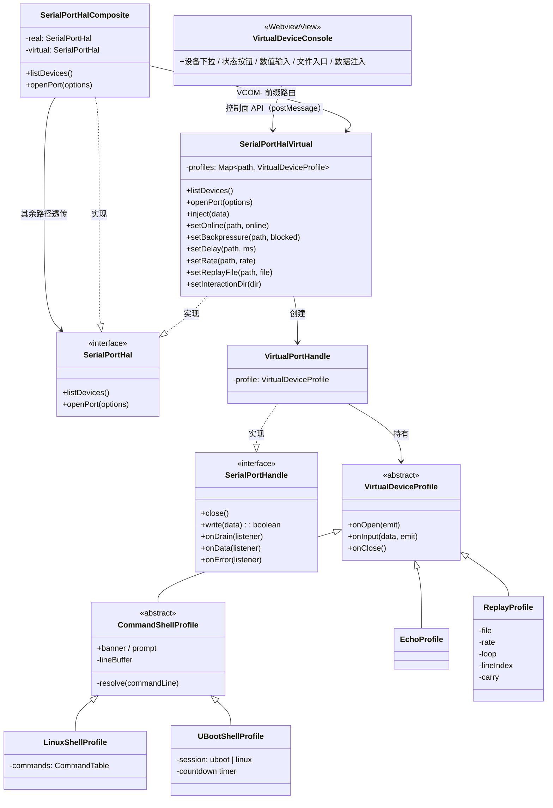

# SerialPortHalVirtual 设计

> 状态：P0–P4 已实现（演进路线收官）｜ 目录：`src/hal/SerialPortHalVirtual/` ｜ 上位文档：[总体架构.md](../总体架构.md) ｜ 契约：[SerialPortHal设计.md](SerialPortHal设计.md)

## 1. 定位

SerialPortHalVirtual 是产品测试模式的载体：`SerialPortHal` 接口的虚拟设备实现，与 `SerialPortHalImpl` 并列，经编译期开关进入构建，仅用于测试模式。上层 Detector、ConnectionService、Connection 与全部 Consumer 零改动地运行在虚拟设备之上，配套虚拟设备控制台（§8）提供设备侧的运行时控制。

用途：

- 无硬件体验完整链路：连接、终端交互、日志保存、AgentBridge 全部可用；
- 开发与调试 agent-bridge-skills：AI Agent 经 AgentBridge 操作虚拟终端；
- 以真实采集日志为数据源，验证日志相关能力（每行时间戳、ANSI 剥离、按大小分割）。

## 2. 设计目标

- **零业务侵入**：虚拟实现只存在于 HAL 层与装配层，不触碰任何服务层与 Consumer，见 [SerialPortHal设计.md](SerialPortHal设计.md) §2「可替换、可测试」；
- **编译期隔离**：虚拟 HAL 经源码开关进入构建，不存在运行时切换与设置切换；生产发布构建必须为真实 HAL；
- **显式区分**：虚拟设备在树视图中带 Virtual 标注，与真实设备明确区分；
- **参数容错**：连接参数（波特率、帧格式、流控）允许正常设置，实现直接忽略，上层连接流程不因虚拟设备产生分支；
- **行为可扩展**：命令应答表驱动，应答目录文件覆盖内置表，新增虚拟指令不需要改代码。

## 3. 设备清单

测试构建下默认提供四台虚拟设备，每台固定一个实例（`listDevices` 只返回虚拟设备）：

| 设备 | 路径 | 画像 | 用途 |
|---|---|---|---|
| 回显设备 | `VCOM-ECHO` | Echo | 管道验证：输入什么回显什么 |
| Linux 终端设备 | `VCOM-LINUX` | LinuxShell | Agent 连接测试：常用命令固定应答 |
| U-Boot 终端设备 | `VCOM-UBOOT` | UBootShell | Agent 连接测试：开机链路（U-Boot → Linux）+ 固定应答 |
| 日志回放设备 | `VCOM-REPLAY` | Replay | 按可调速率回放日志文件 |

设备随画像落地分阶段注册：P0 仅提供 VCOM-ECHO，P1/P2 补齐 Linux / U-Boot / Replay，四台齐备为最终形态。`manufacturer` 字段固定为 `Virtual`——设备列表的行描述与悬浮提示由此自带 Virtual 标注，无需 UI 层改动（完整控制台见 §8）。

设备默认在线；控制台可切换「拔出 / 上线」模拟热插拔事件链（见 §8）。设备身份走退化链第三级（path 兜底）——虚拟设备路径固定且稳定，见 [SerialPortDeviceDetector设计.md](../SerialPortDeviceDetector设计.md) §4.1。

## 4. 设备画像

### 4.1 Echo（回显）

收到什么回什么，数据原样回显。用于验证数据管道与 [AgentBridge](../ConsumerDesign/SerialPortAgentBridge设计.md) 的字节透传。

### 4.2 LinuxShell（虚拟 Linux 终端）

- 打开端口时输出欢迎信息与提示符 `root@localhost:~# `；
- 命令按行匹配应答，内置默认表：

| 命令 | 应答 |
|---|---|
| `help` | 支持的命令清单 |
| `uname -a` | 固定的内核信息行 |
| `ls` / `pwd` | 预置目录列表 / 路径 |
| `echo <文本>` | 回显文本 |
| `cat <文件>` | 预置文件内容 |
| 其余命令 | `bash: <命令>: command not found` |

- 应答来源与文件覆盖约定见 §4.5；
- **远端回显**：画像自行回显键入字符（真实串口终端的回显来自设备端），保证终端内输入可见。

### 4.3 UBootShell（虚拟 U-Boot 终端）

同 LinuxShell：打开时输出版本横幅与提示符 `=>`，内置默认表：

| 命令 | 应答 |
|---|---|
| `help` | 支持的命令清单 |
| `version` | 固定的 U-Boot 版本信息 |
| `printenv` | 预置环境变量 |
| 其余命令 | `Unknown command '<命令>' - try 'help'` |

应答来源与文件覆盖约定见 §4.5。

**开机链路（P4）**：端口打开后进入 U-Boot 会话并启动自动开机倒计时（2 秒，对应 `printenv` 的 `bootdelay=2`）：

```
U-Boot 2023.10-virtual (Nov 05 2026 - 00:00:00 +0800)
Hit any key to stop autoboot: 2
```

- 倒计时数字按秒经退格更新（`2` → `\b1` → `\b0`，真实 U-Boot 行为）；打开后**不先显示提示符**——`=> ` 在倒计时被中断后才出现；
- 倒计时窗口内首个输入块中断倒计时（整块被消费：不回显、不进行缓冲），换行收束倒计时行后显示 U-Boot 提示符，停留在 U-Boot 会话；
- 倒计时自然到期或 U-Boot 会话中执行 `boot` 命令：输出 `\r\n` + 内核启动信息，随后切换 Linux 会话（横幅 + `root@localhost:~# `）；
- Linux 会话中命令表整体切换为 Linux 内置表（`help` / `uname -a` / …），U-Boot 专属命令按 Linux 未知格式回退（如 `bash: printenv: command not found`）；
- 端口 `close` 复位状态机：重开端口重新走 U-Boot 开机链路；`VCOM-LINUX` 保持独立常驻 Linux 设备，不受影响；
- 倒计时与开机信息为设备侧自主输出（画像自带定时器，同 Replay 约定，`onClose` 必须清理），不经 responseDelay 延迟管线；`boot` 命令应答与提示符走常规管线。

### 4.4 Replay（日志回放）

- 数据源为纯文本日志文件（配置 `testMode.replayFile`），**打开端口时读取**（重新连接即加载最新文件），按**原始字节切片**逐行播放（`\r\n` 行尾与多字节字符字节级保真）；
- **速率语义（已定稿）：行/秒**——`testMode.replayRate` = 每秒播放行数，默认 `100`、最小 `1`；内部以 100ms 节拍批发（每节拍 `N/10` 行，余数累进），高速率自动合并为大批次（契合真实串口的 chunk 到达形态）；
- 播放完成（EOF）：`testMode.replayLoop=true` 从头循环，`false` 停止播放（设备保持在线、静默）；
- `replayFile` 未配置或文件不可读：设备照常枚举与打开，但无任何输出（静默设备）；
- **控制台播放状态机（P1 设计需求）**：`idle`（无文件）→ `armed`（已选文件待开始）→ `playing ⇄ paused` → `armed`。选文件进入 armed **不自动播**，由控制台 [开始播放] 显式启动；播放中 [暂停]（进度保留）/ [停止]（回 armed、进度清零、文件保留）；EOF 播放结束回 armed（可再开始）；[取消选择] 清除文件回 idle——**已选文件禁止直接更换**，须先取消选择。端口打开时文件已选仍自动开播（连接即回放契约不变），停止后重新连接亦自动开播；
- 主机侧输入被忽略（回放设备为纯数据源）；播放随端口 close 停止；整文件读入内存（开发工具定位，数十 MB 量级日志可接受）。

### 4.5 应答目录（交互型画像）

LinuxShell 与 UBootShell 的命令应答支持文件覆盖：

- 配置 `serialPortTerminal.testMode.interactionDir` 指定应答根目录，子目录 `linux/`、`uboot/` 分别对应两个画像（两画像存在同名命令，如 `help`，单层目录会冲突）；
- 文件名 = 命令行（如 `uname -a.txt`、`printenv.txt`），文件内容 = 静态应答文本，输出时自动补换行与提示符；
- 子目录或命令文件缺省时回退内置默认表；
- 文件名受 Windows 合法字符限制，含 `\ / : * ? " < > |` 的命令无法以文件覆盖，保留内置表应答；
- Echo 无命令表、Replay 属日志型，均不适用本约定。

## 5. 装配与选择（编译期）

- 开关常量（`src/hal/halSelection.ts` 的 `USE_VIRTUAL_HAL`）**源码字面量恒为 `false`**（发布就绪状态，永不手动修改）；测试构建的开关值由 `scripts/build.js` 在产物级注入（读环境变量替换产物字面量，断言恰好命中 1 处），运行期不存在切换，也不提供设置项；三种编译形态（产品 / 测试 / 单元测试）的配置方法见 [../编译指导.md](../编译指导.md)；
- 本 HAL 仅用于测试模式：`vscode:prepublish` 以 `node scripts/verify-hal-selection.js` 为第二道前置（测试门禁之后），脚本校验源码中开关字面量为 `false`，未复位则非零退出、拒绝打包；
- 测试构建下设备来源为**混排呈现**——`SerialPortHalComposite` 同时持有真实 HAL 与虚拟 HAL，`listDevices` 返回两者并集（真实在前、虚拟在后），`openPort` 按路径前缀路由（`VCOM-` 前缀走虚拟 HAL，其余路径透传真实 HAL）；真实串口命名（`COM*` / `tty*` / `dev/*`）与 `VCOM-` 前缀无冲突；产品构建（开关 `false`）为纯真实 HAL，`verify-hal-selection.js` 校验不受影响；
- 产品化打包：发布 VSIX 不含虚拟设备控制台面板与 `testMode.*` 设置项（`scripts/package.js` 打包时净化清单 + `verify-release-manifest.js` 机械拦截未净化打包，见 [../编译指导.md](../编译指导.md) §4.3）；
- 生命周期语义与真实设备一致：断开、关闭终端面板、扩展停用均走上层统一销毁流程，虚拟句柄在 `close` 时停止回放与定时器。

## 6. 配置（草案）

| 配置项 | 类型 | 默认值 | 说明 |
|---|---|---|---|
| `serialPortTerminal.testMode.replayFile` | string | `""` | 回放设备的纯文本日志文件路径 |
| `serialPortTerminal.testMode.replayRate` | number | `100` | 回放速率（行/秒），最小 1；语义见 §4.4 |
| `serialPortTerminal.testMode.replayLoop` | boolean | `false` | 播放到文件末尾后是否循环 |
| `serialPortTerminal.testMode.responseDelay` | number | `0` | 命令应答延迟（ms），模拟真实设备的异步响应 |
| `serialPortTerminal.testMode.interactionDir` | string | `""` | 交互型画像的应答根目录，约定见 §4.5 |

配置项为草案，实现时定稿。虚拟 HAL 的启停由编译期开关决定（§5），不设运行期测试模式开关。

## 7. 关键机制

### 7.1 输入处理管线

```
handle.write(data) → responseDelay 延迟 → 画像处理 → emit onData(输出)
```

命令应答类画像内部维护行缓冲，按 `\r` 切分出命令行后查表匹配；Echo 与 Replay 不做行缓冲。

### 7.2 背压模拟

控制台状态按钮切换「阻塞 / 放行」：阻塞期间 `write` 返回 `false` 且数据**排队**（模拟驱动缓冲——真实 UART 流控下字节不丢失），放行时按序送达并触发 `onDrain`，为 HAL 的已知限制「write 背压信号未消费」（见 [SerialPortHalImpl实现.md](SerialPortHalImpl实现.md) §5）提供无硬件的验证手段。

### 7.3 参数忽略

`openPort` 对任何 `SerialPortOpenOptions` 都成功打开，参数不生效，仅记录 debug 级日志便于排查。

## 8. 虚拟设备控制台（WebviewView）

侧边栏视图，挂在现有 `serialPortTerminalSideBar` 容器下。**全部虚拟设备共享一个控制台**，仅提供通用控制操作，不含画像专属界面。

| 控制项 | 形式 | 说明 |
|---|---|---|
| 目标设备 | 下拉框 | 切换当前控制的虚拟设备 |
| 在线 / 拔出 | 状态按钮 | 拔出时该设备从 `listDevices` 消失，经 Detector removed 事件走真实的连接销毁链；上线后恢复出现在设备列表 |
| 背压阻塞 / 放行 | 状态按钮 | 控制该设备 `write` 的背压行为（见 §7.2） |
| 应答延迟 | 数值输入 | 精确值（ms），不用滑杆类模糊控件 |
| 回放文件 | 文件选择入口 | 选择纯文本日志文件写入 `testMode.replayFile`；已选后仅显示路径 + [取消选择]（禁止直接更换，取消后可重选） |
| 播放控制 | 状态按钮组 | 待开始：[开始播放]；播放中：[暂停] [停止]；暂停中：[继续] [停止]；未连接且已选文件时提示「连接设备后自动开始播放」 |
| 回放速率 | 数值输入 | 精确值，播放中即时生效 |
| 回放循环 | 状态按钮 | 切换 `replayLoop` |
| 应答根目录 | 目录选择入口 | 选择交互型画像应答根目录，写入 `testMode.interactionDir`（约定见 §4.5） |
| 数据注入 | 文本输入 + 发送 | 以设备侧视角向串口对端注入任意数据，用于模拟设备主动输出 |

实现约定：

- Webview ↔ 扩展主进程经 `postMessage` 通信，消息协议包含 `select` / `setOnline` / `setBackpressure` / `setDelay` / `setRate` / `setLoop` / `play` / `pause` / `stop` / `pickReplayFile` / `clearReplayFile` / `pickInteractionDir` / `inject` 与反向的 `state`（携带 `mode` 与全量设备快照）；文件与目录不走协议传值，由主进程弹出选择器并把结果写入 `testMode.*` 设置（见上表）；
- `SerialPortHalVirtual` 在 `SerialPortHal` 契约之外暴露**控制面 API**（`inject` / `setOnline` / `setBackpressure` / `setDelay` / `setRate` / `setLoop` / `setReplayFile` / `play` / `pause` / `stop` / `setInteractionDir`），仅控制台使用，不影响 HAL 契约本身；
- 控制台随编译期开关进入构建：**视图在 package.json 静态声明且两种构建均注册提供器**（WebviewView 无动态注册机制——声明后不注册会向用户显示错误占位页）；生产构建的页面渲染「虚拟设备控制台仅在测试构建可用」占位（经消息下发 `mode` 区分），控制面逻辑不生效。

> **产品化待办（2026-11-07 记录；预计 v1.5.0 预览版本、v1.5.1 正式版本）**：把 Virtual Device Console 打包进入正式发布版本，作为正式功能向外发布——在设置中提供一个开关（**默认关闭**）控制其可见性与启用，供无真实设备的用户体验完整测试链路。约束与边界：单元测试仍然禁止进入发布包（`.vscodeignore` 屏蔽不变）；该功能**没有数据兼容要求、不影响正式功能**，因此**不保证未来更新时的功能兼容性**（豁免 QuickConfig §4.1 类兼容承诺）。落地面（启动时实施）：产品化打包策略调整——`scripts/package.js` 净化逻辑与 `verify-release-manifest.js` 改为保留控制台视图与 `testMode.*` 设置（由设置开关控制启用），虚拟 HAL 主体仍随开关保持在生产构建不可达，仅控制台前端与设置进入发布包；`doc/编译指导.md` §4.3 同步。当前发布仍按 §4.3 净化策略执行。

## 9. 不做范围

- 桥接本地真实 shell（node-pty 原生依赖，风险等级与 serialport 相同）；
- 用户自定义 expect 规则引擎；
- CTS/RTS 流控线路信号模拟。

## 10. 演进路线

- **P0**（实施拆分见 §10.1）：编译期开关 + prepublish 校验 + HAL 骨架 + Echo 画像，跑通测试构建下的连接与终端交互；
- **P1**（实施拆分见 §10.2）：LinuxShell / UBootShell 画像（内置默认表 + 应答目录覆盖 + 远端回显），支撑 agent-bridge-skills 调试；
- **P2**（实施拆分见 §10.3）：Replay 画像（文件回放、行/秒速率、循环）；
- **P3**：虚拟设备控制台（WebviewView：设备下拉、状态按钮、精确数值输入、文件入口、数据注入）+ 背压模拟；
- **P4**（实施拆分见 §10.5）：U-Boot → Linux 开机链路（自动开机倒计时、`boot` 切换会话）+ 混排路由（真实与虚拟设备共存）；

### 10.1 P0 实施拆分

| # | 内容 | 落点 |
|---|---|---|
| 1 | 编译期开关与 HAL 工厂 | `src/hal/halSelection.ts`：`USE_VIRTUAL_HAL = false` 常量 + `createSerialPortHal()` 工厂；`extension.ts` 改用工厂获取 HAL（默认分支行为不变） |
| 2 | HAL 骨架 | `src/hal/SerialPortHalVirtual/`：`SerialPortHalVirtual`（`listDevices` 返回已注册画像、`openPort` 任意参数成功）、`VirtualPortHandle`（write / onData / onError / onDrain / close，含 `responseDelay` 延迟管线与 close 时定时器清理）、`VirtualDeviceProfile` 抽象基类（`onOpen` / `onInput(data, emit)` / `onClose`） |
| 3 | Echo 画像 | `EchoProfile`：`onInput` 将输入原样 `emit`；P0 仅注册此一台（`VCOM-ECHO`，manufacturer=`Virtual`） |
| 4 | 防误发布校验 | `scripts/verify-hal-selection.js`：校验 `halSelection.ts` 中开关字面量为 `false`；`vscode:prepublish` 追加该前置 |
| 5 | 单元测试 | 用例清单见 `doc/Test/开发测试体系规划.md` §6.5（11 例：设备枚举、参数忽略、回显、保序、延迟、close 语义、订阅口完整性） |

实现约束：虚拟 HAL 不 import `vscode` 与第三方包（`responseDelay` 经构造参数注入、由装配层读配置传入），保持纯逻辑可直接单测；背压 P0 恒为放行（`write` 恒返回 `true`），仅保留接口。

### 10.2 P1 实施拆分

| # | 内容 | 落点 |
|---|---|---|
| 1 | 命令壳基类 | `CommandShellProfile`（抽象，继承 `VirtualDeviceProfile`）：**远端回显**（输入原样 echo，`\r` 回显为 `\r\n`）、**行缓冲**（`\r` / `\n` 为终止符，跨 chunk 累积）、**应答管线**（命令行 → 查应答 → 输出 + `\r\n` 行尾 + 提示符）、`onClose` 清缓冲；`EchoProfile` 不受影响 |
| 2 | LinuxShell 画像 | `LinuxShellProfile`：横幅 `Welcome to Virtual Linux (busybox)` + 提示符 `root@localhost:~# `；内置表 `help` / `uname -a` / `ls` / `pwd` / 参数化 `echo <文本>` / 参数化 `cat <路径>`（固定内容块）；未知命令 `bash: <命令>: command not found` |
| 3 | UBootShell 画像 | `UBootShellProfile`：横幅 `U-Boot 2023.10-virtual` + 提示符 `=> `；内置表 `help` / `version` / `printenv`（预置环境变量块）；未知命令 `Unknown command '<命令>' - try 'help'` |
| 4 | 复合命令解析 | 按 `;` 分隔依次执行、输出顺序拼接——**设计点，支撑 agent-bridge-skills 的标准模式** `echo __MARK_BEGIN__; <命令>; echo __MARK_END__`（标记检测要求各标记独占一行，无此解析则虚拟 Linux 无法配合技能仓库） |
| 5 | 应答目录覆盖 | 画像构造参数注入 `interactionDir`（装配层读 `testMode.interactionDir` 传入，纯逻辑约束不变）；子目录 `linux/`、`uboot/`；文件名 = 命令行 + `.txt`、内容 = 应答文本；**优先级：精确文件 > 精确内置 > 参数化内置 > 未知回退**；目录/文件缺省回退内置；Windows 非法文件名字符的命令无法覆盖，保留内置表 |
| 6 | 注册 | `halSelection.ts` 测试分支注册三台设备（Echo + Linux + UBoot），`listDevices` 返回三项；均 manufacturer=`Virtual` |
| 7 | 单元测试 | 用例清单见 `doc/Test/开发测试体系规划.md` §6.6（20 例） |

行为细节（实现即定稿）：应答与提示符行尾一律 `\r\n`（真实串口终端习惯，term.js 的独占一行标记检测兼容）；空回车（仅 `\r`）只回显换行 + 新提示符；`responseDelay` 延迟作用于整个 `onInput` 分发（回显与应答同时延迟到达），逐 chunk 时序微调归 P3 控制台。

> **现状（2026-11-05）**：P1 已实现——`CommandShellProfile` 基类 + Linux / U-Boot 两画像按上表落地，20 例单测全绿（`doc/Test/开发测试体系规划.md` §6.6），复合命令解析（#4）按推荐实现。

### 10.3 P2 实施拆分

| # | 内容 | 落点 |
|---|---|---|
| 1 | Replay 画像 | `ReplayProfile`（继承 `VirtualDeviceProfile`，不经命令壳基类）：构造注入 `(file?, rate = 100, loop = false)`；`onOpen` 读取文件 + 启动 100ms 节拍批发（余数累进）；EOF 按 `loop` 循环/停止；`onClose` 清定时器；`onInput` 忽略；文件按原始字节切片（含行尾），内容字节级保真 |
| 2 | 装配 | `halSelection.ts` 注册第四台设备（读 `replayFile` / `replayRate` / `replayLoop` 配置注入）；`SerialPortHalVirtual` 默认注册集扩为四台 |
| 3 | 单元测试 | 用例清单见 `doc/Test/开发测试体系规划.md` §6.7（13 例，`mock.timers` 控时） |

实现约束沿用 §10.1：纯逻辑（仅 Node 内建 fs）、无 vscode 依赖；运行时速率调整归 P3 控制面 API。

### 10.4 P3 实施拆分

| # | 内容 | 落点 |
|---|---|---|
| 1 | 控制面与运行态 | `VirtualPortHandle`：延迟/背压改读 per-profile **运行态对象**（`delay` / `backpressure` 可变）；阻塞时 write 排队返回 `false`，放行按序送达 + `onDrain`；新增 `injectFromDevice(data)`（设备侧注入 → onData） |
| 2 | 控制面 API | `SerialPortHalVirtual` 增 per-profile 运行态（`online` / `delay` / `backpressure` / `rate` / `loop` / `file`）与 `inject` / `setOnline` / `setBackpressure` / `setDelay` / `setRate` / `setLoop` / `setReplayFile` / `setInteractionDir`；`listDevices` 过滤离线画像、`openPort` 拒绝离线路径；`ReplayProfile` / `CommandShellProfile` 增对应 setter（interactionDir 即时生效） |
| 3 | 控制台视图 | `src/view/SerialPortConsoleView.ts`：`WebviewView` 提供器（挂 `serialPortTerminalSideBar`）+ 内联 HTML/JS（CSP nonce）+ postMessage 协议 + `state` 推送；生产构建渲染「仅在测试构建可用」占位 |
| 4 | 装配与清单 | `halSelection` 导出 `USE_VIRTUAL_HAL` + `createVirtualHal()`（返回 `SerialPortHalVirtual \| undefined`）；`extension.ts` 注册控制台（携带虚拟 HAL 实例）；`package.json` contributes.views 声明 `serialPortConsole` + configuration 声明 5 个 `testMode.*` 设置 |
| 5 | 单元测试 | 用例清单见 `doc/Test/开发测试体系规划.md` §6.8（13 例：控制面语义 + 背压队列 / drain + 在线拔出 + live 调整；Webview 页面本身归 P1 集成测试范围） |

> **现状（2026-11-05）**：P2 已实现——`ReplayProfile` 按上表落地（节拍累进采用 ms 基整数规避浮点漂移），13 例单测全绿（`doc/Test/开发测试体系规划.md` §6.7），四台虚拟设备齐备（§3 最终形态）。

> **现状（2026-11-06）**：P3 已实现——上表五项全部落地：控制面运行态（`VirtualRuntime` 按引用共享，控制面修改即时作用于存活句柄）、8 个控制面 API + 离线过滤/拒绝、控制台视图（`state` 推送 + 占位页）、装配与清单（`createVirtualHal()`、`serialPortConsole` 视图、5 个 `testMode.*` 设置）、13 例控制面单测全绿（`doc/Test/开发测试体系规划.md` §6.8）。Webview 页面交互归 P1 集成测试范围。

> **P1 补充（2026-11-07，控制台回放状态机）**：回放画像增播放状态机（`idle / armed / playing / paused`，见 §4.4），控制面 API 增 `play` / `pause` / `stop`，快照字段增 `playback` / `connected`；控制台回放区改按钮组交互——选文件不自动播（显式 [开始播放]）、已选文件禁止直接更换（[取消选择] 后可重选）。连接时文件已选仍自动开播（P2 契约不变）。

### 10.5 P4 实施拆分

| # | 内容 | 落点 |
|---|---|---|
| 1 | 开机链路状态机 | `UBootShellProfile`：会话状态（`uboot` / `linux`，`close` 复位）；`onOpen` 覆写为输出横幅 + 倒计时行并启动按秒退格更新（画像自带定时器，`onClose` 清理并复位）；倒计时窗口内 `onInput` 首个输入块中断（整块消费、不回显不缓冲）；到期或 `boot` 命令 → 内核启动信息 + Linux 会话切换（`banner` / `prompt` / 内置表 / 未知格式按会话取值，Linux 侧委托内嵌 `LinuxShellProfile`，避免命令表双份维护）；`VCOM-LINUX` 画像不变 |
| 2 | 混排路由 | `src/hal/SerialPortHalComposite.ts`：实现 `SerialPortHal`，构造注入 `(real, virtual, prefix = 'VCOM-')`（依赖接口而非具体实现，测试以桩注入真实侧）；`listDevices` = 两侧并集（真实在前）；`openPort` 按前缀路由——前缀命中走虚拟（含离线拒绝），其余透传真实 HAL（未知设备的明确报错由真实侧给出） |
| 3 | 装配 | `halSelection.ts`：恢复 `createSerialPortHal(virtualHal)` 工厂——`virtualHal` 非空（`USE_VIRTUAL_HAL = true`）→ `new SerialPortHalComposite(new SerialPortHalImpl(), virtualHal)`（混排，真实 + 虚拟共存）；`undefined` → 纯 `SerialPortHalImpl`（现状不变）；`extension.ts` 改用该工厂获取 HAL（虚拟实例仍单独持有，供控制台使用）；`verify-hal-selection.js` 校验逻辑不变 |
| 4 | 单元测试 | 用例清单见 `doc/Test/开发测试体系规划.md` §6.9（开机链路 12 例 + 混排路由 6 例，`mock.timers` 控时；新测试文件，套件版本 minor +1） |
| 5 | 构建参数化开关 | `scripts/build.js` 读 `USE_VIRTUAL_HAL` 环境变量、产物级注入开关值（替换后断言恰好命中 1 处，防发射格式漂移静默失效）、指纹增 `virtualHal` 字段；`.vscode/tasks.json` 增 `compile:test-hal` 任务（`options.env` 注入）、`launch.json` 默认 `Debug` 挂测试构建、新增 `Debug (real HAL)` 挂默认构建；源码字面量自此恒 `false`（配置方法与原理见 [../编译指导.md](../编译指导.md)） |
| 6 | 产品化打包 | `scripts/package.js`（`npm run package`）：备份清单 → 净化（移除 `serialPortConsole` 视图、5 个 `testMode.*` 配置及对应本地化键，前后结构断言）→ `vsce package` → `finally` 恢复清单；`scripts/verify-release-manifest.js` 挂 prepublish 链尾机械拦截未净化打包；发布 VSIX 无虚拟设备控制台面板与 `testMode.*` 设置项（产物中虚拟 HAL 编译物运行时不可达，彻底剔除归打包器 tree-shaking，不为此引入依赖） |

实现约束沿用 §10.1：纯逻辑、无 vscode 依赖；倒计时定时器归画像自带（同 `ReplayProfile` 先例）；控制台不新增画像专属控件（§8 通用控制定位不变，开机链路无需控制面 API）。

> **现状（2026-11-06）**：P4 已实现——上表四项全部落地：开机链路状态机（`UBootShellProfile` 会话切换 + 按秒退格倒计时定时器 + close 复位，Linux 命令表/提示符委托内嵌 `LinuxShellProfile`）、`SerialPortHalComposite` 混排路由（前缀路由 + 并集枚举真实在前）、装配（`createSerialPortHal(virtualHal)` 组合混排，生产构建纯真实 HAL 不变）、18 例单测全绿（`doc/Test/开发测试体系规划.md` §6.9）。**HalVirtual 演进路线（P0–P4）至此全部完成。**

## 11. 组件结构


